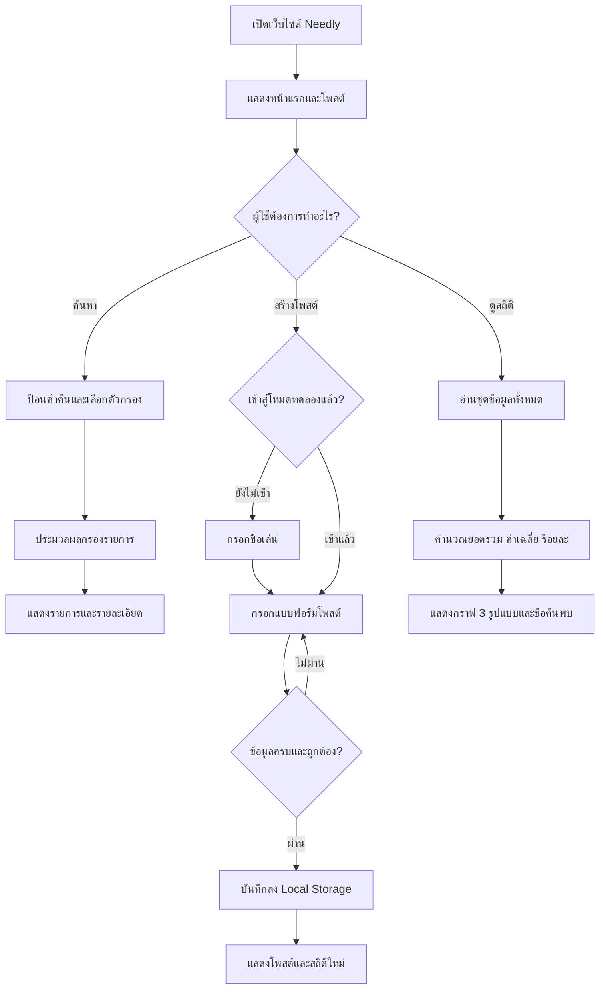

# Needly — เอกสารประกอบ Mini Project IS401101

## 1. การวิเคราะห์ปัญหา
การขอความช่วยเหลือและการแบ่งปันของใช้ในชุมชนมักกระจายตามช่องทางต่าง ๆ ผู้ที่ต้องการช่วยเหลือจึงค้นหาคำขอที่เหมาะสมได้ไม่สะดวก เว็บต้นแบบ Needly จัดข้อมูลตามหมวดหมู่และสถานะให้ง่ายต่อการค้นหา

ผู้ใช้เป้าหมาย: นักเรียน นักศึกษา สมาชิกชุมชน และผู้ที่ต้องการส่งต่อทรัพยากร

วัตถุประสงค์: สร้างโพสต์ได้ ค้นหาได้ จัดการสถานะได้ และสรุปภาพรวมข้อมูลด้วยกราฟ

ขอบเขต: ต้นแบบระบบฝั่งเบราว์เซอร์ ไม่มีการจับคู่หรือแลกเปลี่ยนข้อมูลระหว่างผู้ใช้จริง

## 2. Flowchart การทำงานหลัก

## 3. โครงสร้างข้อมูล (ตารางเบื้องต้น)
| ชื่อข้อมูล | ความหมาย | ชนิดข้อมูล | ตัวอย่าง | การนำไปใช้ |
|---|---|---|---|---|
| id | รหัสโพสต์ | Number | 1 | อ้างอิงโพสต์ |
| title | หัวข้อคำขอ | String | รับบริจาคหนังสือ | ค้นหาและแสดงผล |
| category | หมวดหมู่ | String | books | กรองและกราฟแท่ง |
| description | รายละเอียด | String | รวบรวมหนังสือ... | แสดงรายละเอียด |
| location | จังหวัดหรือพื้นที่ | String | กรุงเทพมหานคร | ค้นหา |
| date | วันที่สร้าง | String (YYYY-MM-DD) | 2026-10-09 | เรียงลำดับและกราฟเส้น |
| status | สถานะคำขอ | String | open | กรองและกราฟโดนัท |
| helps | จำนวนครั้งที่สนใจช่วย | Number | 3 | หาผลรวม |
| owner | เจ้าของในเดโม | String | demo-user | จำกัดเมนูแก้ไข |

## 4. การวิเคราะห์ข้อมูล
1. ผลรวมโพสต์ทั้งหมด = COUNT(โพสต์)
2. ค่าเฉลี่ยจำนวนโพสต์ต่อช่วงสัปดาห์ = จำนวนโพสต์ที่สร้างในช่วงย้อนหลัง 6 สัปดาห์ ÷ 6
3. อัตราโพสต์สำเร็จ (%) = จำนวนโพสต์สถานะ `closed` ÷ จำนวนโพสต์ทั้งหมด × 100
4. กราฟแท่ง = COUNT รายหมวดหมู่
5. กราฟโดนัท = สัดส่วนของสถานะ open/matched/closed
6. กราฟเส้น = COUNT โพสต์ที่มีวันที่อยู่ภายในแต่ละสัปดาห์ย้อนหลัง 6 สัปดาห์

หมายเหตุ: ค่าเฉลี่ยจำนวนโพสต์ต่อสัปดาห์ต้องใช้เฉพาะโพสต์ที่อยู่ในช่วง 6 สัปดาห์ย้อนหลังตามแกนกราฟ จึงต่างจากยอดรวมโพสต์ทั้งหมดได้

## 5. กรณีทดสอบอย่างน้อย 3 กรณี
| ID | กรณีทดสอบ | ขั้นตอน | ผลที่คาดหวัง |
|---|---|---|---|
| T01 | สร้างโพสต์ถูกต้อง | เข้าสู่โหมดทดลอง แล้วกรอกข้อมูลครบกดบันทึก | มีโพสต์ใหม่ในหน้าของฉันและยอดรวมเพิ่ม 1 |
| T02 | กรอกข้อมูลไม่ครบ | สร้างโพสต์โดยเว้นหมวดหมู่/รายละเอียด | ระบบไม่บันทึกและแสดงการตรวจสอบฟอร์ม |
| T03 | ค้นหา/กรอง | เลือกหมวดหมู่หนังสือ + สถานะรอช่วยเหลือ | แสดงเฉพาะโพสต์ที่ตรงตัวกรอง |
| T04 | เปลี่ยนสถานะ | เลือกโพสต์ของฉันแล้วเปลี่ยน open เป็น closed | สถานะบนการ์ด/กราฟอัปเดตทันที |
| T05 | รีเฟรชเบราว์เซอร์ | สร้างโพสต์แล้วกด Refresh | ข้อมูลยังอยู่ในเบราว์เซอร์เดิม |
| T06 | Responsive | เปิดเว็บด้วยมือถือและเดสก์ท็อป | เมนูและการ์ดปรับตามขนาดหน้าจอ |

นำตารางนี้ไปบันทึก **ผลที่เกิดขึ้นจริง (Pass/Fail)** หลังจากสมาชิกกลุ่มทดลองตามขั้นตอนด้วยตนเอง

## 6. แนวทางบันทึก AI Development Log
โจทย์กำหนดตัวอย่าง Prompt + ผลลัพธ์ + การตรวจสอบ/ปรับปรุง 3 รายการ นักศึกษาควรบันทึกจากการใช้งานจริง เช่น (1) ออกแบบหน้า UX/UI (2) วิเคราะห์โครงสร้างข้อมูลและกราฟ (3) ตรวจและแก้ข้อผิดพลาดจากการทดสอบ ไม่ควรระบุว่าทดสอบผ่านถ้ายังไม่ได้ตรวจจริง
